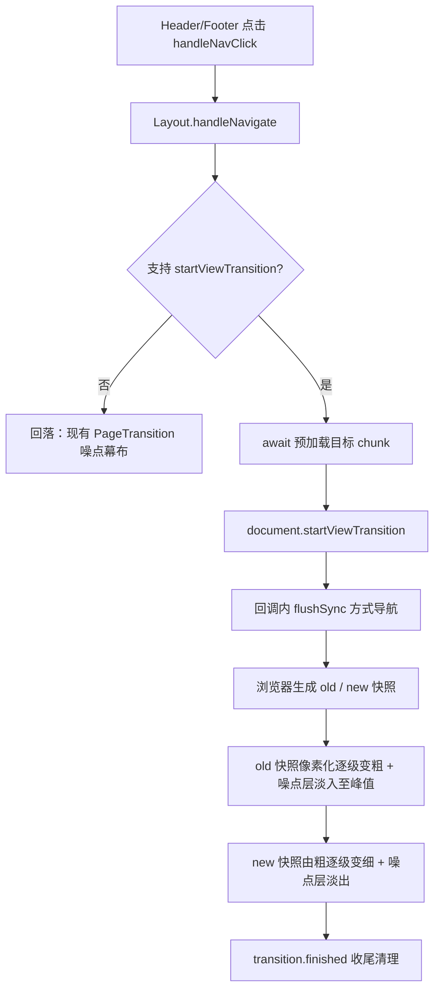

## 产品概述

把路由切换的过渡动画从「噪点幕布盖住页面」改为「页面自身像素化崩解，再由噪点凝聚出新页面」。保留数字/游戏感与噪点元素，但让页面内容本身成为被破坏和重组的对象。

## 核心功能

- **崩解段**：当前页面马赛克粒度由细逐级变粗（如 1→2→4→8→16→32），直至画面成为纯噪点
- **凝聚段**：新页面从噪点中反向还原，粒度由粗逐级变细，最终清晰成形
- **噪点峰值**：两段交界处叠加一层噪点，强化「崩解到纯噪点」的临界点
- **回落与对比**：不支持的浏览器自动回落到现有噪点幕布；另提供模式开关，便于新旧效果对照调参
- **无障碍**：尊重 `prefers-reduced-motion`

## 视觉效果

方块粒度按倍数跳变而非平滑插值，画面像信号崩坏一样碎成大色块，再一格格拼回成形，呈现数字/游戏质感。页头与页脚保持稳定，不参与崩解，避免整屏抖动。


## 技术栈

沿用现有栈：Vite 7.2.4 + React 19.2 + react-router-dom 7.13 + GSAP 3.14.2 + Tailwind 3.4。**不新增任何运行时依赖**。

核心技术选型：**View Transitions API**。它是唯一能免费拿到「旧页面 / 新页面真实像素快照」的途径——浏览器会把两个状态各截成一张图，分别挂在 `::view-transition-old()` 与 `::view-transition-new()` 上，而这两个伪元素是可替换元素，**可以施加 CSS `filter`、`transform`、`width/height`、`opacity`、`mix-blend-mode`**。这正好让「页面自己的像素被破坏」成为可能。

已否决的两条路：
- **html2canvas 截图**：单次 100–500ms，必须在动画开始前完成，且有跨域图与字体坑
- **直接给活 DOM 套 SVG 滤镜**：每帧重栅格化整个子树必卡；文字发虚；`filter` 会创建包含块，会打乱站里的 `position: fixed` 元素（那道细线、播放器特效）

浏览器支持已铺开：Chrome/Edge 111+、Safari 18+、**Firefox 144（2025 年 10 月）已支持 View Transitions Level 1**。

## 实现方案

### 两种像素化机制，主选在前

| 机制 | 做法 | 成本 | 判断 |
|---|---|---|---|
| **A. 降采样 + 放大（主选）** | 伪元素 `width/height` 设为 `100%/N`，配合 `transform: scale(N)`、`transform-origin: 0 0`、`image-rendering: pixelated` | 纯 GPU 合成，几乎为零 | 首选。且 N 按 1/2/4/8/16/32 跳变恰好就是「数字感」而非平滑插值 |
| **B. SVG 像素化滤镜（备选）** | `feFlood` + `feTile` 网格 + `feMorphology dilate`，block size 由 GSAP `attr` 补间驱动 | `feMorphology` 是逐像素形态学运算，满屏 1080p 下有掉帧风险 | A 不成立时启用 |

机制 A 的关键不确定性：浏览器是否在合成阶段按图层的**布局尺寸**栅格化再放大（这样才是硬边方块），还是会按最终合成尺寸重新栅格化（那样就是模糊放大，像素化失效）。现有 `global.css` 里已经带 `transform: translateZ(0)` 与 `will-change: opacity`，图层提升条件具备，但**必须由用户在浏览器实测确认**。这是本方案唯一需要真机验证的点。

### 时序必须反转

现设计是「先放动画，0.7s 时才 `navigate()`」；VT 要求「回调里同步换 DOM，视觉全靠快照撑」。反转后新页面在动画开始瞬间就挂载完毕，**顺带消除了此前报告的「懒加载未就绪会露出空白」风险**（`LazyWrapper` 是 `fallback={null}`）。

### 懒加载必须先等待

VT 的回调里若目标 chunk 未就绪，`flushSync` 会撞上 Suspense，新快照截到的就是空白。必须把 `preloadComponent` 从「发射即忘」改为**可 await**，等 chunk 就位后再 `startViewTransition`。chunk 仅数 KB，延迟可忽略。

## 实现要点（基于实际代码）

### 1. `global.css:320-343` 是沉睡代码，接通后会复活并冲突

```css
@view-transition { navigation: auto; }
::view-transition-old(main-content) { animation: 0.3s ease-out both fade-out; ... }
::view-transition-new(main-content) { animation: 0.4s ease-in 0.1s both fade-in; ... }
```

`@view-transition { navigation: auto }` **只对跨文档导航生效**，本站是 SPA，全仓搜索 `startViewTransition` 零命中，所以这段从未执行过。一旦接通就会接管动画，必须整体重写为崩解/凝聚关键帧，并删除失效的 `@view-transition { navigation: auto }`。

### 2. `Layout.jsx` 改造点（已确认行号）

- L15-22 `preloadComponents` 映射表、L50-54 `preloadComponent` → 改为返回 Promise 并 `await`
- L57-68 `handleNavigate` → 改为「await 预加载 → 检测支持 → `document.startViewTransition` 或回落」
- L71-76 `handleAnimationProgress`、L79-83 `handleAnimationComplete` → VT 路径不再需要「0.7s 触发导航」，仅回落路径保留
- **上一轮刚做的引用稳定性修复必须保住**：回调不稳定会导致时间线中途重建，回落路径下仍会重现「闪一下」

### 3. `PageTransition.jsx` 的去向

保留，作为回落模式，不破坏性删除。它现有的噪点 canvas 生成逻辑（`generateNoise`）可直接复用于新效果的噪点峰值层，避免重复造轮子。

### 4. 参数必须集中可调

这是纯观感效果，**本环境无法做视觉与帧率验证**。必须把 block size 序列、两段时长、噪点峰值时刻与强度抽成单一常量对象，让用户能在浏览器里快速迭代，而不是散落在 CSS 关键帧和 JS 里。

### 5. 其他

- `src/main.jsx:17-21` 启用 `<StrictMode>`，dev 下 effect 双调用；VT 路径下导航是一次性副作用，需防重入
- Header 的 `brand-header`、Footer 的 `global-footer` 保持不变，它们不参与崩解
- 不动 `MouseTrail`、`NoiseOverlay`

## 架构设计



## 目录结构

```
src/
├── components/
│   ├── animation/
│   │   ├── transitionParams.js      # [NEW] 集中可调参数：模式开关、block size 跳变序列、
│   │   │                            #        两段时长、噪点峰值时刻与强度。供 JS 与 CSS 共享
│   │   ├── PixelDissolve.jsx        # [NEW] 像素化崩解的运行时部分：注入 SVG 滤镜 defs（机制 B 启用时）、
│   │   │                            #        驱动噪点峰值层、监听 transition.ready/finished 做收尾
│   │   └── PageTransition.jsx       # [MODIFY] 保留为回落模式；其 generateNoise 逻辑抽出复用于噪点峰值层，
│   │                                #          不得破坏上一轮的引用稳定性修复
│   └── layout/
│       └── Layout.jsx               # [MODIFY] 导航时序反转：await 预加载 → 能力检测 → startViewTransition
│                                    #          或回落；清理过渡期状态
└── styles/
    └── global.css                   # [MODIFY] 重写 320-343 行沉睡段落为崩解/凝聚关键帧；
                                     #          删除失效的 @view-transition navigation: auto；
                                     #          补 prefers-reduced-motion 降级
```

## 关键代码结构

```js
// src/components/animation/transitionParams.js
// 集中可调参数：本效果需反复在浏览器调观感，参数必须单点可改
export const TRANSITION = {
  mode: "pixel",            // "pixel" | "noise"（回落与对照用）
  blockSteps: [1, 2, 4, 8, 16, 32], // 马赛克粒度跳变序列，刻意用倍数而非平滑插值
  dissolveIn: 0.45,         // 旧页崩解时长（秒）
  dissolveOut: 0.45,        // 新页凝聚时长（秒）
  noisePeakAt: 0.5,         // 噪点峰值时刻（归一化到整段）
  noisePeakOpacity: 0.85,   // 噪点层峰值不透明度
}
```

```xml
<!-- 机制 B 备选：SVG 像素化滤镜，block size 由 GSAP attr 补间驱动 -->
<filter id="pixelate" x="0" y="0" width="100%" height="100%">
  <feFlood x="0" y="0" width="2" height="2" result="dot"/>
  <feComposite in="dot" in2="SourceGraphic" operator="in" width="8" height="8" result="cell"/>
  <feTile in="cell" result="grid"/>
  <feComposite in="SourceGraphic" in2="grid" operator="in" result="sampled"/>
  <feMorphology in="sampled" operator="dilate" radius="4"/>
</filter>
```

## 验证

- `npm run lint`、`npm run build` 通过，dist 12.07 MB 与 index chunk 约 34.5 KB 不退化
- **本环境无法做视觉与帧率验证**，以下三项必须由用户在浏览器确认：
  1. 崩解/凝聚观感是否符合预期（重点：机制 A 是否真的产生硬边方块而非模糊放大）
  2. 1080p 下 DevTools Performance 录制不掉帧
  3. 通过模式开关确认旧噪点幕布仍可用、不支持 VT 的浏览器能正确回落


## Agent Extensions

### SubAgent

- **code-explorer**
  - Purpose：改造完成后做静态复核——确认 `global.css` 中失效的 `@view-transition` 已清除且崩解关键帧就位、`Layout.jsx` 的导航时序已反转且预加载已改为可 await、`PageTransition.jsx` 回落路径未被破坏（上一轮的引用稳定性修复仍在）、未误动 Header/Footer 的 `view-transition-name`
  - Expected outcome：输出带文件行号的核对报告，指出任何遗漏、死代码残留或误伤
