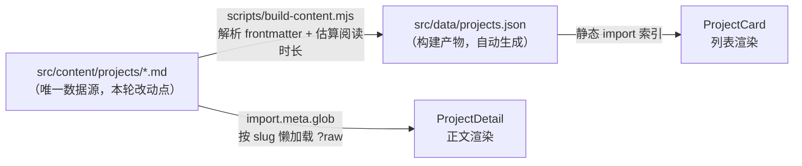

## 产品概述
把个人站点的作品集列表与详情页，从当前 2 条与 GitHub 实际不符的内容，更新为反映 SOMWHY 账号真实公开仓库的内容。

## 核心功能
- **删除 `loopspace-radio`**：GitHub 账号下不存在对应仓库，从作品集中移除
- **新增 4 个项目**：按价值降序补入 `Lineform-See-the-music`、`RAG-`、`clipGIF`、`react-masonry-layout`
- **重排顺序**：全部 5 个项目按项目价值排序
- **中英双语**：沿用现有做法，英文为原文、中文为 title_zh / summary_zh 覆盖字段
- **写实正文**：只写可从仓库核实的事实（描述、技术栈、语言、线上地址、创建时间），不编造指标与背景故事

## 明确不收录
PageNeko、JSON2Hyperframes、pi-mcp-market（用户点名低价值）；clerk-try（信息过少）；11 个 fork（含 pi-dsh-pet，虽 4 星但非原创，放入个人作品集性质不清晰）。


## 技术栈
沿用项目现状，不引入任何新依赖：

- 源码格式：Markdown + YAML frontmatter（`gray-matter` 解析）
- 索引生成：Node 脚本 `scripts/build-content.mjs`，挂 `prebuild` / `predev`
- 渲染链路：`projects.json` 索引 → `ProjectCard` 列表 → `import.meta.glob` 按 slug 懒加载正文 → `ProjectDetail` 渲染
- 双语：`localized(meta, field, locale)` 取 `meta[field_locale] ?? meta[field]`

## 实现方案

### 关键架构事实（决定所有改动落在哪里）

**`src/data/projects.json` 是构建产物，不是源文件**，由 `scripts/build-content.mjs` 生成。因此**只改 `src/content/projects/*.md`，JSON 由脚本重算，绝不手工编辑**。

文件名机制：

```26:31:d:/web_dev_projects/personal_website/scripts/build-content.mjs
const ORDER_PREFIX = /^(\d+)-(.+)\.md$/
const PLAIN_NAME = /^(.+)\.md$/
```

排序前缀 `NN-` **不进 slug**，`src/utils/content.js:29-32` 的 `slugFromPath` 同样会 `fileName.replace(/^\d+-/, "")`。结论：**可以安全重编号，slug 与路由 `/works/<slug>` 不变，无需改任何路由代码**。

必填 frontmatter（缺失会 throw）：`title`、`summary`、`role`、`period`、`stack`（必须非空数组）。
可选：`repo`、`demo`、`cover`、`title_zh`、`title_en`、`summary_zh`、`summary_en`。`readingMinutes` 自动估算。

### 列表顺序（文件名前缀决定）

| 前缀 | slug | 依据 |
|---|---|---|
| 01 | `lineform-see-the-music` | 7 星 / 2 fork、MIT、有线上 demo、topics 完整 |
| 02 | `rag` | 用户点名高价值 |
| 03 | `somwhy-site` | 现有条目，仅重编号，正文不动 |
| 04 | `clipgif` | 自建工具，描述完整 |
| 05 | `react-masonry-layout` | npm 库源码 |

### 数据填写口径（每条必须可核实）

- `title` / `title_zh`：仓库名或 npm 包名（包名不翻译）
- `summary`：**直接取 GitHub description 原文**；`summary_zh` 为忠实中译
- `stack`：仅从仓库 `language` + `topics` 推导，不确定的宁缺
- `repo`：`https://github.com/SOMWHY/<repoName>`，注意保留原始大小写
- `demo`：仓库 homepage 有值才填；**`somwhy-site` 的 homepage 即本站自身，保持 `null` 不自指**
- `period`：只写创建月份（`YYYY.MM`）。理由是 `updated_at` 仅代表最后一次 push，写成 `A — B` 构成误导；完整创建日期写入正文
- `role`：`Solo developer`。注意该字段无 `_zh` 覆盖机制，双语下统一显示
- `cover`：全部 `null`（`ProjectCard` 不渲染该字段，无需准备图片）

### 正文结构（写实短文，不得编造）

统一为「一句话概述 → 技术栈 → 链接 → 时间线」四段，**不写 Background / Problem / Outcome，不写任何量化指标**，区别于现有 `01-somwhy-site.md` 的长篇叙事体。

### 实现注意事项

1. **`RAG-` 无 description**，可核实信息仅 TypeScript、`rag-iota-six.vercel.app`、2026-10-16 创建。正文会明显偏薄——这是信息本身的限制而非写作失误，需在交付时提示用户补充口述描述
2. **`react-masonry-layout` 与本站关系**需在执行时先核实：检查 `package.json` 依赖或 `src/pages/Photos.jsx` 是否真的用到。**确认不了就绝对不写**这句关联
3. `updated_at` 精确值不确定，正文只写 `created_at`，不写不确定的日期
4. **不要触碰** `src/pages/Links.jsx:41-42`、`src/locales/{zh,en}/links.json:7`、`src/components/layout/Footer.jsx:43`——Loopspace 在这三处是独立的 Links 页与页脚导航，用户只要求从作品集删除

## 架构设计

内容层单向数据流，本轮只改最左端：



`gray-matter` 要求 `---` 必须在文件最开头（脚本已用 `stripLeadingComments` 兼容前置 HTML 注释，但新增文件不要依赖该兜底）。

## 目录结构

```
personal_website/
├── src/
│   ├── content/
│   │   └── projects/
│   │       ├── 01-lineform-see-the-music.md  # [NEW] 3D 音频可视化。7 星、MIT。summary 取仓库 description 原文「3d音频可视化 /3D audio visualizer」，stack 取自 topics（three-js / react-three-fiber / wavesurfer-js / zustand / vite / tailwindcss-v4），demo 填 netlify.app 地址
│   │       ├── 02-rag.md                     # [NEW] 仓库名带尾连字符 RAG-，但 slug 用文件名派生的 rag。description 为空，summary 只能写「TypeScript 实现的 RAG 应用」级的可核实表述，demo 填 Vercel 地址。需提示用户口述补充
│   │       ├── 03-somwhy-site.md             # [MODIFY] 仅由 01-somwhy-site.md 重命名而来，内容与 frontmatter 一字不改，避免丢失现有长篇 case study
│   │       ├── 04-clipgif.md                 # [NEW] FastAPI + yt-dlp + ffmpeg 自建 GIF 工具。summary 取英文原文，demo 留 null（仓库无 homepage）
│   │       ├── 05-react-masonry-layout.md    # [NEW] npm 库源码。是否关联本站 Photos 页需先核实，核不实则不写
│   │       └── 02-loopspace-radio.md         # [DELETE] GitHub 无此仓库，用户要求移除
│   └── data/
│       └── projects.json                     # [MODIFY] 由 content:build 重算，条目由 2 变 5，loopspace-radio 消失
```

## 关键数据结构

以下是每个新增 Markdown 必须满足的 frontmatter 契约（`scripts/build-content.mjs:139-146` 强制校验）：

```js
// 必填，缺失即 throw；stack 必须是非空数组
{
  title: string,        // 英文标题
  title_zh: string,     // 中文覆盖，localized() 按 locale 取用
  summary: string,      // 英文摘要，优先取 GitHub description 原文
  summary_zh: string,   // 中文摘要
  role: string,         // 无 _zh 覆盖，双语下统一显示
  period: string,       // 格式 YYYY.MM
  stack: string[],      // 非空数组，否则脚本报错
  repo: string | null,  // https://github.com/SOMWHY/<repoName>
  demo: string | null,  // 仓库 homepage，无则 null
  cover: string | null  // 本项目卡片不用，统一 null
}
```

## 验证清单

1. `npm run content:build` 后核查 `src/data/projects.json`：条目数 5，slug 顺序为 `lineform-see-the-music` / `rag` / `somwhy-site` / `clipgif` / `react-masonry-layout`，`loopspace-radio` 已消失，每个 `stack` 非空
2. 全文搜索确认 `loopspace` 仍在 `Links.jsx` / `locales/*/links.json` / `Footer.jsx` 三处存在且未被误删
3. `npm run lint` 通过
4. `npm run build` 通过，dist 12.07 MB 与 index chunk 约 34.49 KB 不退化
5. 浏览器确认：Works 列表顺序与双语文案正确切换；`/works/rag` 等 5 条路由均可达且正文正常渲染

