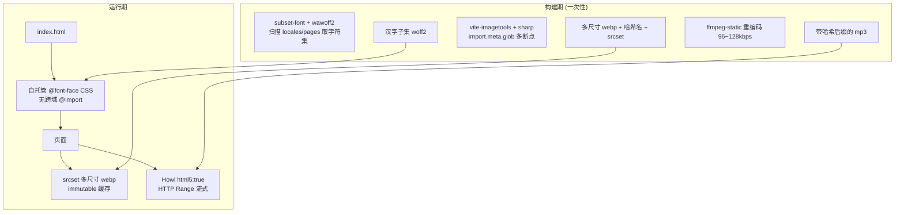

## 产品概述
对 personal_website（Vite + React + Tailwind，部署于 Netlify 的个人站点）做一次面向"线上加载性能"的深度优化。目标是让远端访问时的首渲染速度接近本地预览体验，同时不改变任何现有视觉观感、交互行为与 i18n 文案。

## 核心问题（已实测定位）
- 图片资源共约 3.7 MB、音频共 14 MB，全部通过 `public/` 无哈希直传，`dist/` 总产物 19 MB
- 部署到公网后图片与音乐加载极慢，本地预览正常

## 核心功能
1. **消除字体串行阻塞**：切断 `HTML → CSS → Google Fonts @import → 中文字体` 的跨域串行请求链，改为自托管 + 只保留站内实际用到的汉字子集
2. **图片本地化与多分辨率**：把 Supabase 远程原图、}$

`public/assets` 散图统一收敛为单一资源源，构建期生成带哈希文件名的多尺寸 srcset
3. **音乐流式播放与体积压缩**：让点击后立即发声，不再等待整首下载与解码
4. **拆包与缓存**：消除 511 KB 单 chunk，并为静态资源设置长效缓存策略
5. **清理冗余**：清理重复/孤儿/失效资源与未使用依赖，降低仓库与部署体积

## 边界
- 视觉、交互、i18n 行为保持不变
- 不引入任何需要在 Windows 上本机编译原生二进制的方案（避免重演 optipng 安装事故）
- 不使用 Service Worker / PWA（保持纯静态托管模型）


## Tech Stack Selection

沿用现有栈：**Vite 7 + React 19 + Tailwind 3 + ESM**，部署 **Netlify**。新增依赖全部选择**预编译二进制或 WASM 路线**（绝无 node-gyp / autotools 编译），并已通过 `npm view` 实测版本与兼容性：

| 库 | 版本 | 作用 | 为什么是它 |
|---|---|---|---|
| `vite-imagetools` | **必须锁 `^10.0.1`** | 构建期图片转码/多分辨率/srcset | 10.x peer 为 `vite>=7`、`engines node>=22`；**11.x/12.x peer 是 `vite>=8`，本项目 Vite 7 装不上**，必须钉死 |
| `sharp` | ^0.35（由 vite-imagetools 传递依赖） | 图片处理 | 通过 npm optionalDependencies 分发**预编译二进制**，Windows 免编译，正是上轮 optipng 事故的正确替代 |
| `subset-font` | ^2.9.0 | 汉字子集化 | 基于 **harfbuzzjs WASM**，纯 WASM 无原生编译；可精确按字符集裁切 |
| `wawoff2` | ^2.0.1 | TTF ↔ WOFF2 编解码 | 同为 WASM；可把 fontsource 的 woff2 反解为 TTF 供子集化 |
| `@fontsource/space-grotesk`、`@fontsource/dancing-script`、`@fontsource-variable/azeret-mono` | ^5.3.0 | 拉丁字体自托管 | 官方已按 unicode-range 切好 latin 子集，单文件数 KB，零构建步骤；干掉对 fonts.googleapis.com 的依赖 |
| `ffmpeg-static` | ^5.3.0 | mp3 重编码 | **预编译 ffmpeg 二进制**按平台分发，无编译 |
| Howler（现有） | ^2.2.4 | 音乐播放 | 仅需改 `html5: true` 即获得 HTML5 Audio 的 Range 流式能力，无需换库 |

环境事实：Node **v24.18.0**（满足 vite-imagetools `node>=22`）。当前 npm 版本默认拦截 postinstall，若 `sharp` 二进制未落地需 `npm rebuild sharp`（与上轮 `esbuild` 同处理）。

## Implementation Approach

**总体策略**：把性能瓶颈从"运行时网络传输"前移到"构建期一次性处理"，让浏览器每次请求拿到的都恰好是它需要的最小字节。

四层改动，按收益从大到小：

1. **字体层（最大单点）**
   `src/styles/global.css:2` 的 `@import url("https://fonts.googleapis.com/...")` 被原样保留在产物 CSS 首行（实测 `dist/assets/index-BYaJ7cz1.css` 第 1 行），形成 `HTML → CSS → @import CSS → 字体文件` 的**串行阻塞链**——浏览器必须先下载并解析完 CSS 才能发现字体请求。其中 Noto Sans SC(300/400/700) 与 Noto Sans Mono SC(100/200/300/400) 是中文字体，Google 返回上百个 unicode-range 分片，国内直访通常极慢或不可达。这是"本地快、线上慢"最典型的原因（localhost 不走这条跨域串行链）。
   处理：删除 `@import`；拉丁三件套换 `@fontsource` 自托管；中文用 WASM 子集化脚本按站内真实字符集裁切，体积再降一个数量级。

2. **图片层**
   现状是三套来源混用且全部零优化：`index.html:9-30` preload 的两个 Supabase 远程 PNG（都标了 `fetchpriority="high"`，但其中 `...214427.png` 是 About 页才用的图）、`Home.jsx:161/194`、`About.jsx:89`、`songs.json:7,16,25,34,43`（5 张封面**实际渲染仅 48×48** 却拉原始大图）、以及 `Photos.jsx:58-206` 用字符串路径拼的 21 张本地 webp（合计 3.03 MB，最大 407 KB）。
   处理：资源单一源化 → 远程图本地化 → 构建期生成多尺寸 srcset + 哈希文件名 + `immutable` 缓存。
   附带修一个静默失效 Bug：`Photos.jsx:229-231` 传小写 `fetchpriority`，而 `ImageCard.jsx:12` 解构驼峰 `fetchPriority`，且组件无 rest-spread → 属性被丢弃，分级优先级意图完全没生效。

3. **音频层**
   `playerStore.js:84-86` 是全仓唯一 `new Howl` 处，未配任何性能参数。默认 `html5: false` → 走 Web Audio + XHR，**必须整首下完并 `decodeAudioData` 完成才出声**，最大单曲 4.85 MB，弱网下表现为"点了几十秒没反应"；且 `playerStore.js:80` 的 `isLoading` 锁会让 `play/next/previous` 全部 early-return。
   处理：`html5: true` 启用 `<audio>` 的 HTTP Range 流式边下边播 + ffmpeg 重编码降到 96~128 kbps。已澄清**不存在**"初始化即并发下载 14 MB"（`play()` 才创建 Howl，切歌有 `cleanupHowl`）。

4. **打包层**
   `vite.config.js` 目前只有 `plugins: [react()]`，产物 511.5 KB 单 chunk。`framer-motion` 全仓仅 `Player.jsx` 引用（4 处）→ 懒加载即可彻底离开关键路径；`src/components/index.js` 是 eager barrel 导致 Layout 把 Player/LightOrbs/MouseTrail 全部拉进首屏。

**避免技术债**：`ResponsiveImage.jsx` 已是现成的 `<picture>/srcSet` 实现（当前是死代码且拼的 `_*w.webp` 文件不存在），应**修复并复用它**而不是再写一套；`ImageCard.jsx` 已有 inherit δοmhooks 的骨架占位逻辑，扩展 `srcSet/sizes` 即可。

**已知负面影响与控制**：构建期图片处理会让 build 变慢（21 张 × 数个断点）。建议**只生成 webp 三档断点**，AVIF 仅对首屏 Hero 等 2~3 张开启——sharp 的 AVIF 编码很慢，全量开会让 Netlify 构建从 5 秒涨到数分钟。

## Implementation Notes

- **前置目视核实**：子代理是按文件命名时间戳推断"Supabase 远程 PNG == 本地 `屏幕截图 2026-01-29 214255.webp`"，**未做像素比对**。动手前必须先下载远端原图与本地文件比对，确认一致后才删除远端引用；同时确认 7 个 `屏幕截图*.webp` 孤儿文件确实后续没人用。
- **Assets 单一源**：删除 `copy_assets.bat` 的 xcopy 行为（它正是 `src/assets` 与 `public/assets` 同名同大小重复的源头），图片统一进 `src/assets/`，音频保持在 `public/`（14 MB→约 5 MB 后仍不适合打进 bundle）。
- **`vite.svg` 是 313.6 KB**（正常应约 1.5 KB）且被 `index.html:5` 当 favicon，必须换成真实小图标。
- **缓存头要分层**：Vite 产物自带内容哈希 → `/assets/*` 可 `immutable`；但音频在 `public/` 无哈希 → 由重编码脚本生成短内容哈希后缀（如 `a_farewell_to_spring.a1b2c3.mp3`）并同步改写 `songs.json` 的 `audio` 字段，才敢设 immut`able`。Netlify 多条 headers 规则匹配时用最后一条优先，规则顺序需在实机上验证。
- **npm postinstall 陷阱**：本项目 npm 会拦截安装脚本，`sharp`/`esbuild` 若二进制缺矢表现为 `Cannot find module`，用 `npm rebuild <pkg>` 兜底。
- **Blast radius**：i18n 只做"静态 import 全部 locale → 按语言动态 import"的等价改造，保持 `t()` API 与文案完全不变；`LazyWrapper` 的 fallback 从 `null` 改为轻量骨架可视化处仍有争议，建议保留 `null` 语义、仅在 Navigation 首 JL 渲染上使用，避免引入视觉变化。
- **日志/兼容**：Howler 切 `html5: true` 后不应再依赖 `onload` 拿 `duration`（改用 `load` 后从 `<audio>` 的 metadata 读取），需保证 `playerStore.js:130` 的时长赋值与 `:238/248` 的切歌逻辑在新模式下仍成立（详见任务说明）。建议保留 `Howl` 的 `onplayerror`/`onloaderror` 分支并对流式播放加 `onend` 衔接。
- **约束边界**：不要在 List item 引入 Service Worker / Workbox；不要重建 `vite-plugin-imagemin`。

## Architecture Design

### 改动前 vs 改动后的请求模型



### 模块划分
- **字体管线**：`scripts/subset-fonts.mjs`（字符集收集 → 变量字体 → 子集 → woff2 → `src/assets/fonts/`）+ `src/styles/fonts.css`（`@font-face` + `unicode-range` + `font-display: swap`）
- **图片管线**：`vite.config.js` 挂 `vite-imagetools`；`src/pages/Photos.jsx` 改为 `import.meta.glob`；`src/components/ui/ResponsiveImage.jsx` 修复后作为唯一 `<picture>` 出口；`ImageCard.jsx` 增加 `srcSet/sizes`
- **音频管线**：`scripts/encode-audio.mjs`（ffmpeg 重编码 + 内容哈希改名 + 回写 `songs.json`）+ `playerStore.js` 改 `html5: true`
- **打包与缓存**：`vite.config.js` 的 `manualChunks`；`Layout.jsx` 对 Player 懒加载；`netlify.toml` 的 headers 规则

## Directory Structure

```
personal_website/
├── scripts/
│   ├── subset-fonts.mjs        # [NEW] 汉字子集化脚本。递归扫描 src/locales/**/*.json、src/data/*.json 与 src/**/*.jsx 收集 CJK 字符集（含 ASCII 基础标点与数字），调用 subset-font(harfbuzz WASM) 裁切 Noto Sans SC / Noto Sans Mono SC 源字体，经 wawoff2 压缩输出到 src/assets/fonts/。要求：源字体缺失时给出可执行的提示；字符集需去重排序以便 diff 稳定；输出按 字重 拆an'tou件。
│   ├── encode-audio.mjs        # [NEW] 音频重编码脚本。用 ffmpeg-static 把 src/assets/audio 或 public/assets/audio 的源 mp3 压到 96~128 kbps CBR/VBR，输出的mp3 文件名追加短内容哈希后缀，并同步回写 src/data/songs.json 的 audio 字段。要求：源文件只读不覆盖、编码失败不静默、打印前后体积对比。
│   └── fonts-src/              # [NEW] 一次性提交的中文源字体 TTF（若 @fontsource-variable/noto-sans-sc 提供 full woff2，则改为用 wawoff2.decompress 反解，避免仓库里放大文件）
├── src/
│   ├── styles/
│   │   ├── global.css          # [MODIFY] 删除第 2 行 Google Fonts @import（这是最大的串行阻塞单点），改为 @import "./fonts.css"
│   │   └── fonts.css           # [NEW] 自托管 @font-face。拉丁三件套走 @fontsource 包，中文走 src/assets/fonts/ 子集，带 unicode-range 与 font-display: swap；保留 PingFang SC / Microsoft YaHei / Heiti SC / SimHei 兜底，避免缺字。
│   ├── data/
│   │   └── songs.json          # [MODIFY] cover 字段从 Supabase 远程 PNG 改为本地 has 名路径；audio 字段由 encode-audio.mjs 同步更新为新文件名
│   ├── assets/                 # [MODIFY] 成为图片唯一真源。photos/(21 张)、people/(music_girl_*)、covers/(5 张)、avatar/(原 Supabase 3 张)；fonts/(子集字体产出)
│   ├── pages/
│   │   ├── Photos.jsx          # [MODIFY] 字符串路径数组 → import.meta.glob + vite-imagetools query，产出 srcset；传参由小写 fetchpriority 改为驼峰 fetchPriority（修静默失效 Bug）
│   │   ├── Home.jsx            # [MODIFY] :161/:194 远程 URL → 本地图 + srcset/sizes；移除重复的倒影请求
│   │   └── About.jsx           # [MODIFY] :89 远程 URL → 本地图 + srcset/sizes
│   ├── components/
│   │   ├── ui/ImageCard.jsx    # [MODIFY] 增加 srcSet / sizes / decoding="async" 透传；修复 fetchPriority 大小写契约（或加 rest-spread）
│   │   ├── ui/ResponsiveImage.jsx # [MODIFY] 重写为真正可用的 <picture> 出口，输入改由 vite-imagetools 的 import.meta.glob 结果驱动，取代原先硬拼 _320w.webp 的死逻辑
│   │   ├── ui/PhotoCard.jsx    # [DELETE] 确认无引用后删除
│   │   ├── layout/Layout.jsx   # [MODIFY] :3-11 的 eager barrel 改为按需直接 import；:99 的 <PlayerPortal /> 改为 React.lazy，让 framer-motion 离开关键路径
│   │   └── index.js            # [MODIFY] 移除/惰性化 barrel re-export，避免 Layout 首屏拉入全量组件
│   ├── i18n/config.js          # [MODIFY] :3-16 的 14 个静态 import 改为按语言动态 import，保持 t() API 与文案完全不变
│   ├── store/
│   │   └── playerStore.js      # [MODIFY] :84-86 的 new Howl 增加 html5: true / preload 策略；:130 duration 改从 metadata 读取而非依赖整文件下载；保留 :238/:248 切歌逻辑正确性
│   └── App.jsx                 # [DELETE] 5 行死代码，未被 router 引用
├── public/
│   ├── assets/                 # [MODIFY] 仅保留 audio/ 目录；全部 *.webp 迁走删除（含 7 个无引用的 屏幕截图*.webp，约 0.78 MB）
│   ├── vite.svg                # [MODIFY] 313.6 KB 的异常文件替换为真正的图标（约 1.5 KB）
│   └── page_neko_optimized.js  # [MODIFY] 删除 :809-813 动态注入的重复 /nekos.webp preload
├── index.html                  # [MODIFY] 删除 :9-22 两个 Supabase 远程 PNG 的 preload；:24-30 的 /nekos.webp preload 补 type 属性并降为 low；:35 neko script 加 defer；新增 2 个关键字体的 preload(crossorigin)
├── vite.config.js              # [MODIFY] 挂载 viteImagetools；新增 manualChunks（react / gsap / motion / router+i18n）、assetsInlineLimit、chunkSizeWarningLimit
├── netlify.toml                # [NEW] 缓存策略：/assets/* 设为 immutable；/assets/audio/* 用带 revalidate 的长缓存；HTML 保持必须重新验证。同时保留 _redirects 的 SPA 回退语义
├── package.json                # [MODIFY] 新增 vite-imagetools@^10.0.1 / subset-font / wawoff2 / @fontsource 三件套 / ffmpeg-static；新增 fonts:build、audio:encode 脚本；删除确认无引用的 @supabase/supabase-js、@dnd-kit/*、@headlessui/react、react-transition-group、react-icons
├── copy_assets.bat             # [MODIFY] 移除 xcopy 重复拷贝逻辑（保留占位或标注废弃）
└── page_neko_optimized.js      # [DELETE] 与 public/ 下同名文件重复，index.html 实际引用的是 public 那份
    NeteaseCloudMusicApi/       # [DELETE] 仅含 149 B 的"已停止维护"README，前端零引用
```

## Key Code Structures

1) 图片管线的核心契约（`import.meta.glob` + vignette query，非显而易见，必须精确）：

```js
// src/pages/Photos.jsx —— 替代原有 :58-206 的字符串路径数组
const modules = import.meta.glob(
  "../assets/photos/*.webp",
  {
    query: "?w=320;640;1024;1600&format=webp&as=srcset",
    import: "default",
    eager: true, // 也可 lazy
  }
)
// 注意：lock 版本必须是 vite-imagetools@^10.0.1（11.x/12.x 要求 vite>=8）
```

2) 音频流式播放的契约（`playerStore.js:84-86` 的目标形态）：

```js
const howl = new Howl({
  src: [targetSong.audio],      // 已是带内容哈希后缀的新文件名
  html5: true,                  // 走 <audio> + HTTP Range，边下边播
  preload: "metadata",          // 不再整首下载
  format: ["mp3"],
  onload / onplay / onloaderror / onplayerror / onend,
})
// duration 需改从 metadata 事件读取，不能沿用依赖 onload 的旧赋值时机
```


## Agent Extensions
### SubAgent
- **code-explorer**
  - Purpose: 在资产大规模迁移与删除动作完成后，做一次跨目录的引用完整性复核——确认 `public/assets/*.webp`、被删的重哭组件、`src/assets` 冗余副本、已移除依赖在代码中再无任何静态/动态引用，避免迁移遗漏导致的 404
  - Expected outcome: 输出"零残留引用"的报告；若发现遗漏，给出具体文件与行号清单

- **code-explorer**
  - Purpose: 在优化全部落地后，重新核对 `src/styles/global.css` 的字体栈一致性、`vite.config.js` 分包与 `_redirects`/`netlify.toml` 的行为，以及 `Photos.jsx` / `Home.jsx` / `About.jsx` 的 srcset 落位，确保视觉与 i18n 未退化
  - Expected outcome: 输出一份"改造前后行为等价"的验证清单，含关键 CSS 类名与 i18n key 幸存确认
