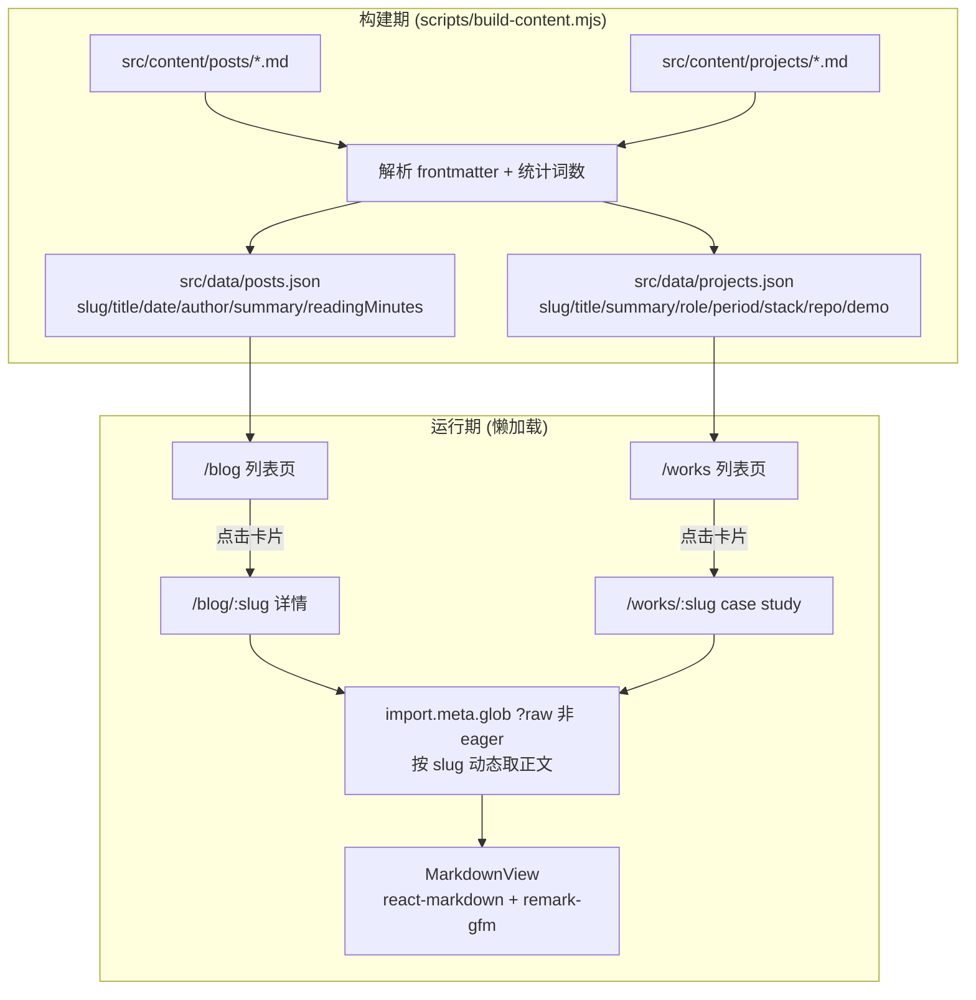

## 产品概述
对 personal_website（Vite + React + Tailwind 个人站点）做一次内容结构改版：把 Works 页从「网易云音乐作品链接」改造为面向前端求职的作品集，删除与 Connection 重复的 Contact 页并把邮箱并入 Connection，在原 /contact 的位置新建 /blog 博客页（站内阅读，不外链）。

## 核心功能
1. **作品集（Works）**：精选项目卡片列表（标题 / 一句话简介 / 技术栈标签 / 角色 / 时间 + GitHub 与 Demo 外链）；点击进入站内 case study 详情子页（背景、难点、方案、结果、截图）
2. **博客（Blog）**：文章卡片列表，展示作者、写于日期、预计阅读时长（mins）；点击后在站内阅读，不外链
3. **Connection 整合**：原 Contact 页的邮箱迁入 Connection 页，其余内容舍弃；/contact 路由移除后访问落到 404
4. **导航与路由**：Contact 项替换为 Blog 项，并修复桌面端导航硬编码英文的既有问题

## 边界
- 不做 301 跳转，旧 /contact 路由直接移除
- 文章正文与 case study 正文按作者原文直出（可能是中文也可能是英文）；导航项、页面/章节标题与元信息标签随目标语言切换
- 未涉及的页面（Home / About / Photos）视觉与行为不得退化
- 上一轮性能优化成果不得退化：图片仍走构建期 srcset，文章正文不得全量进入主 chunk


## 技术栈
沿用现有栈：Vite 7 + React 19 + react-router-dom 7 + Tailwind 3 + i18next/react-i18next + zustand，ESM。

新增依赖（全部纯 JS，无原生编译，规避上一轮 optipng 事故）：
| 库 | 类型 | 用途 |
|---|---|---|
| `react-markdown` | dependency | 运行时渲染 Markdown 正文 |
| `remark-gfm` | dependency | GFM 语法（表格、删除线、任务列表） |
| `gray-matter` | devDependency | 构建脚本解析 frontmatter（只在 Node 侧执行，不进 bundle） |
| `rehype-highlight` | dependency（可裁剪） | 代码块高亮，仅落在博客/项目详情的懒加载 chunk 内 |

## 实现方案

### 核心矛盾与解法：列表元数据 vs 正文懒加载
用户选择「.md 存储 + import.meta.glob 按篇懒加载 + 阅读时长自动算」。但列表页要在**不加载正文**的前提下渲染卡片元数据。

**选定方案 A：构建期生成索引**（与项目已有的 `fonts:build` / `audio:encode`「脚本产出 + 提交产物」约定完全一致）：
- `scripts/build-content.mjs` 读取 `src/content/posts/*.md` 与 `src/content/projects/*.md`，解析 frontmatter、按词数算阅读时长，产出 `src/data/posts.json` 与 `src/data/projects.json`
- 正文用**非 eager** 的 `import.meta.glob("../content/posts/*.md", { query: "?raw", import: "default" })`，返回「路径 → 动态 import 函数」的映射，详情页按 slug 触发，正文单独成 chunk
- 产物 JSON 提交进仓库，并挂 `prebuild` / `predev`，避免忘记手动执行

否决项：B（每篇拆 meta.json + index.md）无法满足「阅读时长自动算」；C（全量 eager ?raw）违背「按篇懒加载」。

### frontmatter 契约
- 文章 `src/content/posts/<slug>.md`：`title` / `date` / `author` / `summary` / `cover`（可选）
- 项目 `src/content/projects/<slug>.md`：`title` / `summary` / `role` / `period` / `stack[]` / `repo` / `demo` / `cover`（可选）
- 两者均支持可选本地化覆盖字段：`title_zh` / `title_en` / `summary_zh` / `summary_en`。渲染规则：存在当前 locale 的覆盖字段则用它，否则回退原文 —— 这一处同时满足「标题翻译为目标语言」与「正文显示原文」两种诉求，无需二选一
- 正文一律原文直出，不做翻译

### 阅读时长估算
`Math.max(1, Math.ceil(CJK字符数 / 350 + 拉丁词数 / 200))`，单位为 mins，在构建期算好写进索引 JSON

### i18n 结构
- `src/i18n/config.js`：namespace `contact` → `blog`（其余 6 个不动）
- 新建 `src/locales/{en,zh}/blog.json`；重写 `works.json`；`links.json` 增 `email` 键；`common.json` 的 `nav.contact` → `nav.blog`（en "Blog" / zh "博客"）；删除 `contact.json`

## 实现要点

### 必须先修的两个既有隐患（否则改动会直接踩雷）
1. **`Links.jsx:49` 悬停预览图按下标取值**：`const linkId = Object.keys(linkImages)[index]`，`linkImages` 只有 5 项。直接插入第 6 个 email 条目时 index=5 会取到 `undefined`，写出 `backgroundImage: url(undefined)`。**必须先把 5 个卡片改成数据驱动数组**（每项自带 key、图标、href、可选预览图），email 条目声明无预览图并在 hover 时跳过淡入
2. **`Header.jsx:371-417` 桌面导航硬编码英文**：`:379/388/397/406/415` 是写死的 "Works/About/Contact/Links/Photos"，没走 `t("nav.*")`；而 `locales/en/common.json:7` 的 `nav.links` 实际值是 "Connection"，导致桌面显示 "Links"、移动遮罩显示 "Connection"。改为 `t("nav.*")` 一并修掉

### 中文字体子集必须补 `.md` 扫描
`scripts/subset-fonts.mjs:40` 的 `SCAN_EXTENSIONS` 是 `[".js", ".jsx", ".json", ".css", ".html"]`，不含 `.md`。中文文章若不参与扫描，汉字会掉回系统字体。需：
- 加入 `.md`
- `:77-82` 的 `stripComments()` 对 `.md` 需跳过（Markdown 里 `//` 可能出现在链接或行内代码中，剥离会误伤字符），按扩展名分分支处理
- 改完后重跑 `npm run fonts:build` 并确认字符集变大、构建无报错

### 图片沿用既有管线
封面图统一放 `src/assets/covers/`，用 `?w=...&format=webp&quality=..&as=srcset` 交给 `vite-imagetools`，复用 `src/components/ui/ImageCard.jsx`（已支持 `srcSet`/`sizes`/`width`/`height`/`aspectRatio`/`fetchPriority`）。禁止直接写裸 ``。

### 性能与爆炸半径控制
- `react-markdown` + `remark-gfm` 只被 `MarkdownView` 引用，而 `MarkdownView` 只被懒加载的 `PostDetail` / `ProjectDetail` 引用 → 自动落在独立 chunk，不进首屏
- 索引 JSON 体积极小（每篇百余字节），随页面 chunk 加载无压力
- `gray-matter` 仅 devDependency，不进 bundle
- 种子内容（示例文章/项目）明确标注占位，避免把假信息当真内容上线

### 种子内容占位约定
创建 2 篇文章 + 2 个项目的示例文件作为管线演示，文件头用 HTML 注释 `<!-- TODO: 替换为真实内容 -->`，正文与 frontmatter 里填 `REPLACE_ME`，交付时提示用户替换。真实项目名、技术栈、仓库地址、文章正文由用户填写。

## 架构设计



## 目录结构

```
personal_website/
├── scripts/
│   ├── build-content.mjs        # [NEW] 内容索引生成脚本。读取 src/content 下全部 .md，解析 frontmatter、
│   │                            #       按 CJK/拉丁分词估算阅读时长，按 date 倒序输出 src/data/posts.json
│   │                            #       与 src/data/projects.json。要求：字段缺失时给出可执行的错误提示（含文件路径），
│   │                            #       输出需稳定排序便于 diff，slug 由文件名派生。
│   └── subset-fonts.mjs         # [MODIFY] SCAN_EXTENSIONS 增加 ".md"；对 .md 跳过 stripComments()
├── src/
│   ├── content/                 # [NEW] 作者撰写的内容源（唯一真源）
│   │   ├── posts/*.md           # [NEW] 博客文章，frontmatter: title/date/author/summary/cover? + 可选 title_zh 等
│   │   └── projects/*.md        # [NEW] 项目 case study 正文，frontmatter: title/summary/role/period/stack/repo/demo/cover?
│   ├── data/
│   │   ├── posts.json           # [NEW] 构建期产出的文章索引（提交进仓库）
│   │   └── projects.json        # [NEW] 构建期产出的项目索引（提交进仓库）
│   ├── assets/covers/           # [NEW] 文章与项目封面图，经 vite-imagetools 处理
│   ├── pages/
│   │   ├── Works.jsx            # [MODIFY] 整页重写：音乐链接列表 → 精选项目卡片网格
│   │   ├── ProjectDetail.jsx    # [NEW] /works/:slug。渲染 case study 正文 + 元信息条（角色/周期/技术栈）+ 外链按钮
│   │   ├── Blog.jsx             # [NEW] /blog。文章卡片列表：标题、摘要、作者、写于日期、预计阅读 mins
│   │   ├── PostDetail.jsx       # [NEW] /blog/:slug。站内阅读：标题、作者、日期、阅读时长 + Markdown 正文
│   │   ├── Links.jsx            # [MODIFY] 5 个链接改为数据驱动数组；新增 email 条目（1928135011@qq.com，
│   │   │                        #          无预览图时跳过 hover 淡入）；修复下标越界隐患
│   │   └── Contact.jsx          # [DELETE] 整页删除（邮箱已迁至 links）
│   ├── components/
│   │   ├── blog/PostCard.jsx    # [NEW] 文章卡片，元信息行用 font-mono 小号大写字距
│   │   ├── blog/MarkdownView.jsx# [NEW] 包装 react-markdown + remark-gfm（+ 可选 rehype-highlight）
│   │   └── works/ProjectCard.jsx# [NEW] 项目卡片：简介 + 技术栈标签 + 角色/时间 + GitHub/Demo 外链
│   ├── router/index.jsx         # [MODIFY] 删除 contact 路由；新增 blog、works/:slug、blog/:slug（均 lazy）
│   ├── components/layout/Header.jsx # [MODIFY] 桌面导航改 t("nav.*")；contact key → blog；改路径 /contact → /blog；
│   │                                #          gear 动画 linkTexts 与 active 判定同步
│   ├── i18n/config.js           # [MODIFY] namespace contact → blog
│   ├── locales/en/|zh/
│   │   ├── common.json          # [MODIFY] nav.contact → nav.blog（en "Blog" / zh "博客"）
│   │   ├── blog.json            # [NEW] 页面标题/章节标签：写于、预计阅读、返回列表、暂无文章
│   │   ├── works.json           # [MODIFY] 改为作品集文案：标题、角色、周期、技术栈、查看详情、查看仓库、在线预览
│   │   ├── links.json           # [MODIFY] 新增 email 键
│   │   └── contact.json         # [DELETE]
│   └── styles/markdown.css      # [NEW] Markdown 正文排版（标题/段落/列表/引用/代码块/图片），适配 dark/light
└── package.json                 # [MODIFY] 新增 deps 与 prebuild/predev 钩子
```

## 关键代码结构

1) 正文懒加载契约（非显而易见，必须精确）：

```js
// src/pages/PostDetail.jsx —— 非 eager，返回 { [path]: () => Promise<string> }
const rawPosts = import.meta.glob("../content/posts/*.md", {
  query: "?raw",
  import: "default",
})
// 按 slug 匹配路径后 await 调用，正文单独成 chunk；列表页只读 src/data/posts.json，绝不 import 正文
```

2) 本地化字段回退契约：

```js
// 当前 locale 有覆盖字段则用它，否则回退作者原文
const localized = (meta, field, locale) =>
  meta[`${field}_${locale}`] ?? meta[field]
```


## 设计风格
延续站点既有的「极简终端 / 暗房显影」美学：等宽字体、大写字距、灰度主调、单一荧光绿强调色，深色/浅色双主题。新页面必须无缝融入，不能像外挂模块。

## 页面与区块规划

### 1. Works 列表页（/works）
- **页头区**：沿用现有 `Works.jsx` 的版式 —— 小号 `font-mono` 大写字距的 section 标签（"SELECTED PIECES"）+ 渐变文字大标题（"FRONTEND WORKS"）
- **项目卡片网格**：单列纵向排布（与 Photos 页一致的节奏），每张卡含：序号、项目名、一句话简介、技术栈标签行（等宽小字、描边胶囊）、角色与周期、右下角外链图标（GitHub / Demo）
- **交互动效**：复用现有 `.link-card` 的 SVG 描边环（hover 时 `strokeDashoffset` 由满到零）+ ScrollTrigger 入场
- **卡片封面**：可选，走 `ImageCard` 的 srcset，默认灰度、hover 转彩色（与 Photos 页一致的语言）

### 2. 项目详情子页（/works/:slug）
- **顶部**：返回链接 + 项目名 + 一句话简介
- **元信息条**：Role / Period / Stack 三栏，等宽小号大写，描边分隔
- **外链区**：View on GitHub、Live Demo 两个描边按钮
- **正文区**：Markdown 渲染，章节为「背景 / 难点 / 方案 / 结果」，配图用 `ImageCard`
- **底部**：返回列表

### 3. Blog 列表页（/blog）
- **页头区**：与 Links 页一致的 `glitch-text` 大标题（"BLOG"）+ 副标题
- **文章卡片**：纵向列表；每张卡含标题、摘要、元信息行 —— 作者 · 写于 YYYY-MM-DD · 预计阅读 N mins（等宽小号、大写字距、muted 色），右下角箭头指示站内阅读
- **空态**：无文章时展示 `empty` 文案，不报错

### 4. 文章详情子页（/blog/:slug）
- **顶部**：返回链接
- **标题区**：标题、作者、日期（"写于"）、阅读时长
- **正文区**：Markdown 渲染，排版走 `markdown.css`，代码块可选高亮
- **底部**：返回列表

### 5. Connection 页（/links）改动
- 在既有 5 条链接之下新增 **Email** 条目（`lucide-react` 的 Mail 图标，`mailto:` 链接），无悬停预览图
- 其余 5 条外观与悬停预览动效完全不变

### 响应式
移动端单列、`px-6`；桌面 `max-w-4xl` 居中、`md:px-0`。技术栈标签自动换行。

## 字体系统
沿用站点字体栈：正文 Space Grotesk / Noto Sans SC，等宽元信息 Azeret Mono，logo Dancing Script。

## Agent Extensions
### SubAgent
- **code-explorer**
  - Purpose：改造完成后做一次跨目录引用完整性复核 —— 确认 `Contact.jsx` / `contact.json` / `nav.contact` 已无任何残留引用，`/contact` 能正确落到 NotFound，新增路由与 i18n key 一一对应，`.md` 已被字体脚本扫描
  - Expected outcome：输出带文件行号的「零残留」报告；若有遗漏给出具体位置清单
